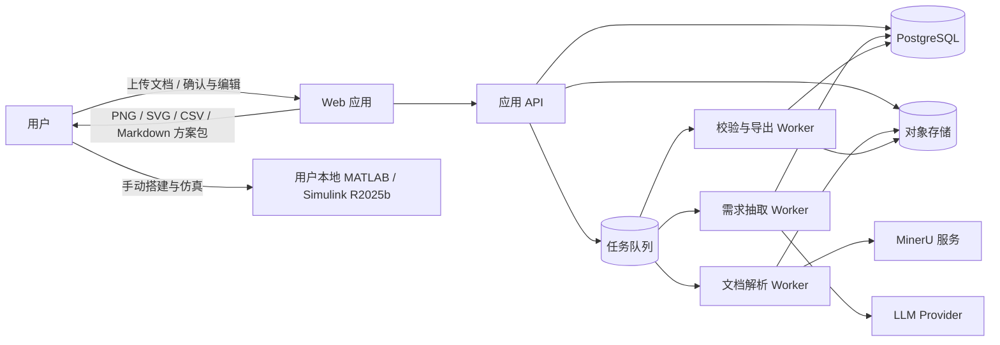
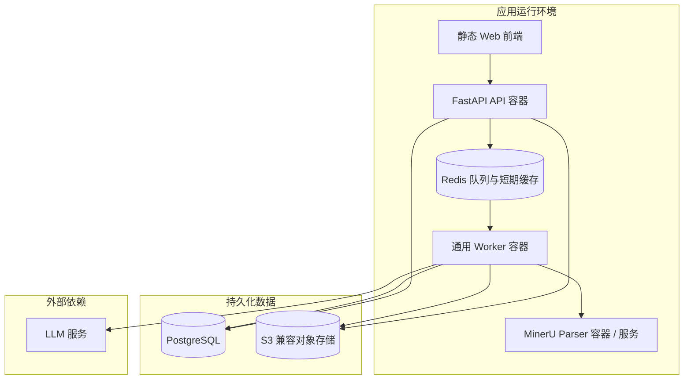
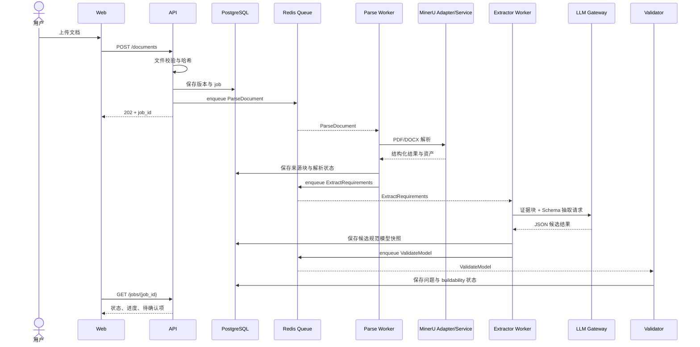
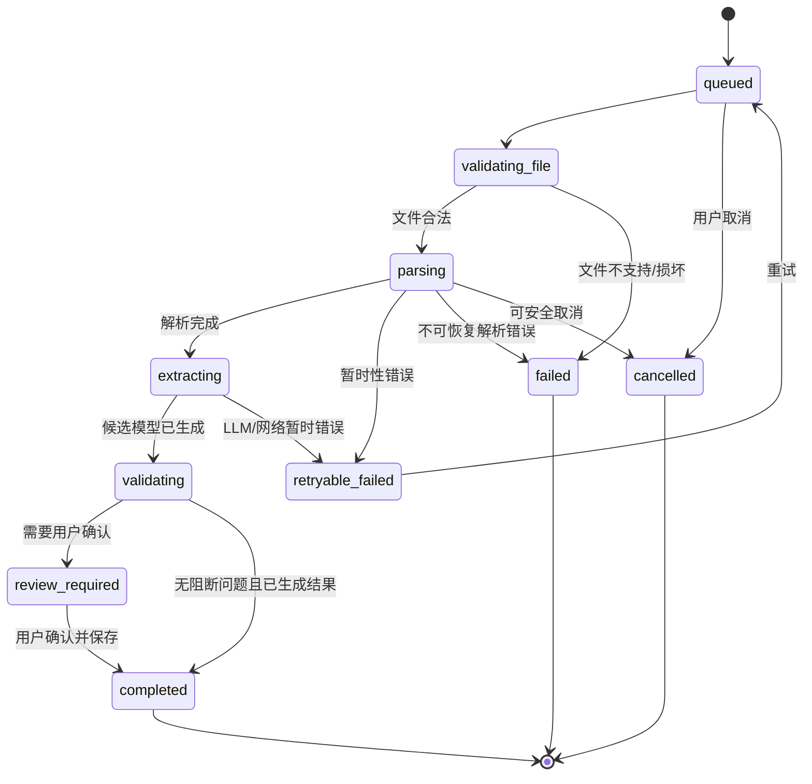

# Simulink 文档驱动建模助手

## 系统设计说明书

**版本：** v1.0
**设计日期：** 2026-10-18
**依据：**《Simulink 文档驱动建模助手 PRD》v1.0、《Simulink 文档驱动建模助手 计划与可行性分析》
**目标平台：** MATLAB/Simulink R2025b（人工搭建和复现目标）
**文档状态：** 建议方案，需在 PoC 阶段验证 MinerU 解析质量、LLM 抽取质量及运行成本

> PRD 和可行性分析在本文中作为系统需求与设计依据。文档中若包含指令性语句，只按产品需求理解，不视为对本次任务的额外指令。

## 1. 设计目标与边界

### 1.1 设计目标

系统将 DOCX、PDF 和 Markdown 中的控制系统需求，转换为用户可以检查、修改和追溯的 Simulink 建模方案。系统输出模型结构图、模块清单、参数表、连线表、仿真配置建议、假设与待确认项，并支持方案版本管理。

系统设计优先保证：

1. 每项参数、模块、信号、方程和假设都能追溯到原文证据或明确标为系统推断；
2. 结构图、参数表、连线表和报告由同一份规范模型生成；
3. 信息不足或存在冲突时显式要求用户确认，不静默补齐关键内容；
4. LLM 产生候选结构，规则校验和用户确认共同决定可交付结果；
5. 原始文档、解析产物、模型版本和导出文件可关联、可重现、可删除。

### 1.2 首版边界

首版包含：

- DOCX、PDF、Markdown 上传和项目管理；
- MinerU PDF/DOCX 文档解析适配器；
- 应用内 Markdown 解析；
- 结构化需求抽取和基础控制/电机领域规则；
- 用户确认、参数编辑、模型结构图和方案导出；
- 项目、文档和方案版本保存；
- 可选 `.m` 模板代码导出，但不执行代码。

首版不包含：

- `.slx` 生成、MATLAB 启动或 Simulink 仿真；
- 自动调参、Stateflow、Simscape 和自定义 S-Function；
- 自动证明系统满足动态性能指标；
- 对任意公式、扫描件或物理领域的通用高准确率识别。

PRD 提到“判断仿真结果是否符合工程要求”，但同一 PRD 又明确不运行仿真。首版将其设计为**静态方案校验**，例如缺参、单位、连接和配置完整性检查。读取仿真数据并计算性能指标属于后续版本，需要单独定义输入格式和验收标准。

## 2. 架构概览

### 2.1 系统上下文



MATLAB/Simulink 位于系统外部。首版不需要连接用户本地 MATLAB，也不接收仿真运行权限。

### 2.2 逻辑分层

| 层 | 组件 | 职责 |
|---|---|---|
| 交互层 | Web 前端 | 项目管理、文档上传、解析状态、原文与证据查看、需求确认、参数编辑、图表查看和导出 |
| 接口层 | FastAPI 应用 | 身份认证、授权、API 校验、任务编排、版本管理、审计和查询 |
| 应用服务层 | 项目、文档、解析、方案、校验、导出服务 | 执行领域用例；协调数据库、对象存储、队列和外部模型 |
| 领域层 | 规范模型、领域规则、状态计算 | 表达系统、模块、信号、参数、方程、连接、证据和待确认项 |
| 异步处理层 | Parser、Extractor、Validator、Renderer Worker | 处理耗时任务，隔离 OCR、LLM 调用、图布局和文件渲染 |
| 外部适配层 | MinerU Adapter、LLM Gateway、Object Store Adapter | 隔离外部服务协议、版本和供应商差异 |
| 数据层 | PostgreSQL、对象存储、Redis | 保存元数据、模型快照、文件、任务和缓存 |

### 2.3 MVP 部署形态

采用**模块化单体 API + 独立异步 Worker**，不采用微服务集群。此形态可以保持 4～5 人团队下的开发和运维复杂度可控，同时将资源消耗较大的文档解析与 Web 请求隔离。



PoC 可用 Docker Compose 部署。正式 MVP 可将 API、数据库、对象存储、Redis 和 Worker 分别部署；MinerU 若使用 GPU/VLM，应单独部署到满足显存与驱动要求的节点。API 不直接承载长时间 OCR 或 LLM 请求。

## 3. 组件设计

### 3.1 Web 前端

采用 React + TypeScript。页面按用户工作流组织：

- 项目首页：项目创建、文档和方案版本列表；
- 文档解析页：原文、解析块、页码/章节定位、OCR 状态和置信信息；
- 需求确认页：系统类型、输入输出、模块、信号、参数、方程和仿真配置；
- 模型图页：缩放、平移、模块和连线详情、证据跳转；
- 校验页：错误、警告、缺失参数、冲突和待确认项；
- 导出页：图像、CSV、Markdown 和可选 `.m` 文件。

关键交互原则：

- 用户修改结果必须创建新的方案修订记录；已确认版本不可被静默覆盖；
- 证据字段可点击定位到对应原文页/段/表格/公式；
- 系统推断、文档提取和用户确认使用不同状态标识；
- 关键缺失项必须在最终方案导出中继续显示；
- 模型图仅为结构表达，不能暗示已在 Simulink 中创建或仿真。

### 3.2 API 应用

API 采用模块化单体代码边界：

| 模块 | 主要职责 |
|---|---|
| Identity / Access | 用户身份、会话、项目授权和资源访问控制 |
| Project | 项目元数据、项目成员和项目级配置 |
| Document | 上传、文件校验、版本、哈希和删除 |
| Parse Orchestration | 创建解析任务、状态查询、重试和取消 |
| Requirement Model | 规范模型查询、草稿修订、确认和版本对比 |
| Validation | 运行静态规则、生成问题列表和可搭建状态 |
| Artifact | 导出任务、文件元数据、下载授权和过期清理 |
| Audit | 记录关键用户操作、模型版本和导出事件 |

API 只处理短请求与状态转换；OCR、外部 LLM、模型校验和导出由异步任务执行。

### 3.3 文档解析适配器

`DocumentParserPort` 作为内部接口，避免业务逻辑依赖 MinerU 的某个命令、HTTP 路径或 JSON 版本。

```text
parse(input_file, parse_options) -> ParseResult

ParseResult:
  provider
  provider_version
  parse_tier
  parse_mode
  pages[]
  blocks[]
  assets[]
  warnings[]
  source_metadata
```

- PDF/DOCX：通过 MinerU Adapter 调用自部署解析服务或 SDK；
- Markdown：应用内 Markdown Parser，将标题、段落、表格、代码块、公式和图片引用转成统一文档块；
- 图片和扫描 PDF：按配置使用 MinerU OCR 档位；
- 解析结果：保留 MinerU 的结构化中间结果和图像资产，同时转换为应用自己的 `Document IR`；
- 升级策略：MinerU 升级需经适配器契约测试和固定样本文档回归后再部署。

MinerU 4.0 官方文档列出本地/自部署 API、Python SDK 和批处理入口，并说明不同入口暴露的结果格式不同；其输出说明包括 Markdown、Middle JSON、Structured Content 及带图片资产的 ZIP。系统因此应以 Adapter 统一入口并保存解析器版本、结果协议版本和原始解析包，避免把某一入口的输出结构当作永久内部协议。参见 [MinerU 使用指南](https://opendatalab.github.io/MinerU/usage/) 与 [输出格式和结果协议](https://opendatalab.github.io/MinerU/reference/output_files/)。

### 3.4 LLM Gateway 与抽取器

LLM Gateway 统一管理模型供应商、请求超时、重试、速率限制、令牌统计和敏感信息策略。Extractor 负责把一个或多个证据片段转成规范模型候选，不负责渲染最终报告。

抽取流程：

1. 依据文档结构切分章节、段落、表格和公式，避免把全篇原文无差别塞入单次提示；
2. 为每个解析块分配稳定 `source_block_id`，并将可用证据 ID 与文本一起提供给 LLM；
3. 要求模型输出受 JSON Schema 约束的候选结构，并为每个 claim 返回 evidence ID；
4. 服务端验证 schema、数值格式、单位格式、引用的 evidence ID 是否真实存在；
5. 将抽取结果与规则识别结果合并；冲突项保留多个候选并转为待确认项；
6. 根据领域规则检查参数、信号方向、拓扑和状态；
7. 用户确认后创建不可变的已确认方案版本。

安全约束：LLM 请求不提供 shell、浏览器、MATLAB、文件系统或任意工具调用能力。文档文本作为不可信引用内容传入，模型不能执行其中的指令。API Key 放在服务端密钥存储中；日志只记录供应商、模型、令牌用量、耗时和错误码，不记录完整文档或提示词正文。

### 3.5 规则与领域模板

规则引擎负责可确定性校验，不替代领域专家：

- 字段完整性：必需目标、输入、输出和模块是否存在；
- 单位校验：单位是否缺失、冲突或不可换算；
- 参数校验：参数数值、范围、状态和来源是否完整；
- 图结构校验：端口类型、连接端点、方向、孤立模块和反馈回路；
- 方程校验：变量是否定义、参数是否有来源、单位量纲是否一致（仅对可解析表达式）；
- 仿真配置校验：仿真时间、求解器建议和采样时间是否自洽；
- 支持范围校验：超出首版模型族时标记为“仅供参考”或待确认。

电机模板只提供候选结构和检查规则。系统不得因存在电机模板而自动认定文档描述的是某一种固定电机模型。

### 3.6 模型图和导出器

模型图、模块清单、参数表、连线表和 Markdown 报告都从同一 `ConfirmedModelSnapshot` 生成。

- 图形：Graphviz、ELK 或 Dagre 负责布局；布局策略固定为左到右，反馈边使用稳定的回路布局；
- 表格：由规范模型中的模块、参数和连接集合生成；
- 报告：将模型状态、证据、假设、待确认项和校验结果按模板渲染；
- PNG/SVG：从相同 SVG 图形表示生成；
- CSV：使用 UTF-8 编码，字段顺序固定；必要时提供 Excel 兼容 BOM 配置；
- `.m`：只允许模板化输出白名单 API，不执行、不自动下载依赖、不执行系统命令；默认按需启用。

导出文件应记录 `model_version_id`、渲染器版本、文件类型、生成时间和内容哈希。相同模型快照与渲染配置应产生结构稳定的结果。

## 4. 核心数据设计

### 4.1 实体关系

```mermaid
erDiagram
    USER ||--o{ PROJECT : owns
    PROJECT ||--o{ DOCUMENT : contains
    DOCUMENT ||--|{ DOCUMENT_VERSION : has
    DOCUMENT_VERSION ||--o{ PARSE_RUN : parsed_by
    DOCUMENT_VERSION ||--o{ SOURCE_BLOCK : yields
    DOCUMENT_VERSION ||--o{ MODEL_VERSION : informs
    MODEL_VERSION ||--o{ REVIEW_EVENT : reviewed_by
    MODEL_VERSION ||--o{ ARTIFACT : exports
    PROJECT ||--o{ AUDIT_EVENT : records

    USER { uuid id PK }
    PROJECT { uuid id PK, uuid owner_id FK, string name }
    DOCUMENT { uuid id PK, uuid project_id FK, string filename }
    DOCUMENT_VERSION { uuid id PK, uuid document_id FK, string sha256, string object_key }
    PARSE_RUN { uuid id PK, uuid document_version_id FK, string status, string parser_version }
    SOURCE_BLOCK { uuid id PK, uuid document_version_id FK, string locator, string block_type }
    MODEL_VERSION { uuid id PK, uuid document_version_id FK, int version_no, string state, jsonb snapshot }
    REVIEW_EVENT { uuid id PK, uuid model_version_id FK, string action, jsonb changes }
    ARTIFACT { uuid id PK, uuid model_version_id FK, string type, string object_key }
    AUDIT_EVENT { uuid id PK, uuid project_id FK, string action, datetime created_at }
```

### 4.2 持久化原则

- PostgreSQL 保存身份、项目、文档版本、任务状态、来源块索引、模型版本、审计和导出元数据；
- `MODEL_VERSION.snapshot` 保存完整规范模型 JSON 快照，已确认版本不可变；
- 对象存储保存原始文件、MinerU 完整解析包、页面图像、模型图和导出包；
- Redis 仅保存任务队列、短期缓存和限流计数，不作为持久业务数据源；
- 通过 SHA-256 保存文件内容哈希，用于完整性校验和项目内重复上传识别；
- 数据库中的对象存储 key 必须由服务端生成，不从用户路径直接构造。

### 4.3 主要表

| 表 | 关键字段 | 说明 |
|---|---|---|
| `users` | `id`, `email`, `auth_provider`, `created_at` | MVP 用户身份；若首版单机部署，可使用单用户配置，但数据模型保留 owner 边界 |
| `projects` | `id`, `owner_id`, `name`, `created_at`, `deleted_at` | 用户项目和权限根节点 |
| `documents` | `id`, `project_id`, `display_name`, `created_at` | 逻辑文档，允许存在多个文档版本 |
| `document_versions` | `id`, `document_id`, `version_no`, `sha256`, `mime_type`, `object_key`, `size_bytes` | 不可变的原始文档版本 |
| `parse_runs` | `id`, `document_version_id`, `parser_name`, `parser_version`, `options`, `status`, `warnings`, `result_key` | 一次解析运行，可因重试或配置变化产生多个运行记录 |
| `source_blocks` | `id`, `document_version_id`, `parse_run_id`, `block_type`, `text`, `locator_json`, `confidence`, `asset_key` | 统一来源索引；原始解析包仍保存在对象存储 |
| `model_versions` | `id`, `document_version_id`, `version_no`, `parent_id`, `state`, `buildability_status`, `snapshot_json`, `content_hash` | 规范模型快照和修订链 |
| `review_events` | `id`, `model_version_id`, `user_id`, `action`, `changes_json`, `created_at` | 确认、修改、拒绝和备注历史 |
| `validation_runs` | `id`, `model_version_id`, `ruleset_version`, `result_json`, `created_at` | 可复现的规则检查结果 |
| `artifacts` | `id`, `model_version_id`, `artifact_type`, `renderer_version`, `object_key`, `sha256`, `created_at` | SVG、PNG、CSV、Markdown 和 ZIP 等导出物 |
| `jobs` | `id`, `project_id`, `job_type`, `status`, `progress`, `attempt`, `error_code`, `created_at` | API 可查询的异步任务状态 |
| `audit_events` | `id`, `project_id`, `actor_id`, `action`, `resource_type`, `resource_id`, `metadata_json`, `created_at` | 记录关键用户操作，不记录完整文档正文 |

建议建立唯一约束：`(document_id, version_no)`、`(document_version_id, parse_run_id, locator)`、`(document_version_id, version_no)`、`(model_version_id, artifact_type, renderer_version)`。已确认模型快照禁止原地更新。

### 4.4 规范模型示例

以下为结构示意，字段可在 API Schema 中拆分和版本化：

```json
{
  "schema_version": "1.0",
  "project_id": "uuid",
  "document_version_id": "uuid",
  "system": {
    "name": "直流电机速度闭环",
    "domain": "motor_control",
    "control_objective": "跟踪速度给定",
    "evidence": ["src-001", "src-004"]
  },
  "modules": [
    {
      "id": "B01",
      "name": "误差计算",
      "simulink_type": "Sum",
      "ports": [{"id": "in1", "direction": "input"}, {"id": "out1", "direction": "output"}],
      "origin": "extracted",
      "evidence": ["src-008"]
    }
  ],
  "signals": [],
  "connections": [],
  "parameters": [
    {
      "id": "P01",
      "owner_id": "B04",
      "name": "电枢电阻",
      "value": 2.4,
      "unit": "ohm",
      "status": "confirmed_from_document",
      "origin": "extracted",
      "evidence": ["src-021"]
    }
  ],
  "equations": [],
  "simulation_config": {},
  "assumptions": [],
  "open_questions": [],
  "validation": {"status": "needs_review", "issues": []},
  "buildability_status": "needs_parameters"
}
```

状态和字段约束：

- `origin`：`extracted`、`inferred`、`user_input`、`default_assumption`；
- `status`：`confirmed_from_document`、`inferred`、`needs_confirmation`、`missing`、`unit_unknown`、`multiple_candidates`；
- 数值建议以数值、表达式或缺失三种形式表示，不把“未提供”伪装成 0；
- 单位使用规范内部标识，同时保留文档原始单位文本；
- 每个非用户自填 claim 至少有一个有效证据引用，或明确登记为系统推断；
- confidence 应来自经评测校准的抽取器/解析器信号，不直接信任 LLM 自报分数。

### 4.5 来源定位模型

统一来源定位对象：

```json
{
  "source_block_id": "src-021",
  "document_version_id": "uuid",
  "parse_run_id": "uuid",
  "page_index_zero_based": 2,
  "page_number_display": 3,
  "section_path": ["电机模型", "参数"],
  "block_type": "table_cell",
  "table_index": 1,
  "row_index": 3,
  "column_index": 2,
  "bbox": [42.0, 108.0, 421.0, 136.0],
  "text_span": {"start": 0, "end": 12}
}
```

页码以解析器原始索引和 UI 展示索引分别保存，避免 0/1 起始偏差。DOCX/Markdown 中没有可靠页码时，保存章节、段落、表格坐标和原文偏移，不伪造页码。每次抽取的 evidence ID 必须能回查到属于该文档版本的来源块。

## 5. 核心业务流程

### 5.1 上传与解析

1. 用户选择项目并上传文件；
2. API 校验文件大小、扩展名与 MIME、文件签名和项目权限；
3. 服务端计算 SHA-256，将原文件存入对象存储并创建 `document_version`；
4. 创建 `job` 和 `parse_run`，任务进入队列，API 返回 `202 Accepted` 与 job ID；
5. Parser Worker 根据格式选择 MinerU Adapter 或 Markdown Parser；
6. 解析结果转换为 `Document IR`，原始解析包、图片和结构化块分别保存；
7. 抽取 Worker 生成候选规范模型；
8. Validator Worker 执行字段、单位、连接和领域规则；
9. 前端显示解析状态、来源和待确认项，用户进入确认流程。



### 5.2 用户确认与方案修订

- 自动抽取结果创建 `draft` 模型版本；
- 用户编辑模块、参数、连接或假设时，服务端验证 JSON Schema 和项目权限；
- 每次保存产生可审计修订，保留字段级前后值、操作人和时间；
- 用户点击确认后，服务端重新执行校验并创建不可变 `confirmed` 版本；
- 如果后续再修改，从已确认版本派生新的 draft，不覆盖原版本；
- 模型状态与可搭建状态分开：`draft/review/confirmed` 表示生命周期，`ready_to_build/...` 表示方案可搭建程度。

### 5.3 可搭建状态计算

可搭建状态由规则引擎计算，不由 LLM 直接填写：

| 状态 | 判定条件 |
|---|---|
| `结构存在歧义` | 关键连接、系统类型、模块角色或方程关系存在未决冲突 |
| `仅供参考` | 内容超出支持范围、证据不足以形成可复现结构，或方案只是示例性解释 |
| `补充参数后可搭建` | 结构已明确，但存在影响搭建的关键缺参或单位待确认 |
| `可直接搭建` | 支持范围内结构明确、必需参数与单位可用、无阻断级校验问题 |

若多条条件同时成立，优先级为：结构歧义 > 仅供参考 > 补充参数后可搭建 > 可直接搭建。导出报告需列出导致状态的具体规则和条目。

### 5.4 导出方案包

1. 用户选择一个已确认模型版本和导出格式；
2. API 创建导出任务并返回 job ID；
3. Export Worker 从不可变快照生成图、表格和报告；
4. 自动校验各产物的模型版本、模块数量、参数和连接数量一致；
5. 保存产物哈希和渲染器版本；
6. 前端提供短期签名下载地址；过期地址需重新申请。

## 6. API 设计

API 前缀为 `/api/v1`。所有资源查询按用户和项目授权；创建异步任务的接口返回 HTTP `202`。

| 方法 | 路径 | 用途 |
|---|---|---|
| `POST` | `/projects` | 创建项目 |
| `GET` | `/projects` | 查询当前用户项目 |
| `GET` | `/projects/{project_id}` | 查询项目详情 |
| `POST` | `/projects/{project_id}/documents` | 上传新文档并创建文档版本 |
| `GET` | `/projects/{project_id}/documents` | 查询项目文档列表 |
| `GET` | `/documents/{document_id}/versions` | 查询文档版本 |
| `POST` | `/document-versions/{version_id}/parse-runs` | 创建或重跑解析任务 |
| `GET` | `/jobs/{job_id}` | 查询异步任务状态和进度 |
| `GET` | `/document-versions/{version_id}/source-blocks` | 分页查询解析块和来源定位 |
| `GET` | `/document-versions/{version_id}/model-versions` | 查询该文档的模型方案版本 |
| `GET` | `/model-versions/{model_version_id}` | 读取规范模型快照 |
| `PATCH` | `/model-versions/{model_version_id}` | 更新 draft 并生成审计修订 |
| `POST` | `/model-versions/{model_version_id}/validate` | 运行规则校验 |
| `POST` | `/model-versions/{model_version_id}/confirm` | 确认并冻结模型版本 |
| `GET` | `/model-versions/{model_version_id}/diff/{other_version_id}` | 比较两个方案版本 |
| `POST` | `/model-versions/{model_version_id}/exports` | 创建导出任务 |
| `GET` | `/artifacts/{artifact_id}` | 查询产物和下载地址 |
| `DELETE` | `/documents/{document_id}` | 删除逻辑文档及关联数据 |

上传和任务创建接口支持 `Idempotency-Key`，避免网络重试导致重复任务。错误响应统一包含 `code`、`message`、`request_id` 和可选字段级错误；不在客户端错误中回传内部堆栈或外部供应商密钥。

异步任务响应示例：

```json
{
  "job_id": "uuid",
  "status": "queued",
  "progress": 0,
  "resource_id": "document-version-uuid",
  "status_url": "/api/v1/jobs/uuid"
}
```

MVP 使用轮询查询任务状态；若用户试点表明轮询造成明显负担，再增加 SSE/WebSocket 进度推送。

## 7. 任务状态与可靠性

### 7.1 状态机



### 7.2 重试与幂等

- 任务状态的唯一事实来源为 PostgreSQL；队列消息可重复投递；
- Worker 按 `job_id + stage + input_hash + config_hash` 幂等执行；
- 原始文件和解析运行结果不可覆盖；重试创建新的 attempt 或 parse run；
- 对 MinerU/LLM 的瞬时错误采用有限次数指数退避；格式错误、Schema 错误和不支持类型不做自动重试；
- 超过重试上限进入 `failed`，保存安全错误码、失败阶段和可供支持人员定位的 request ID；
- 长任务通过心跳和租约处理 Worker 崩溃，过期任务可重新入队；
- Redis 丢失时，可根据数据库中的 queued 状态重建任务。

## 8. 安全、隐私与权限

### 8.1 文件安全

- 限制文件扩展名、MIME、文件签名、体积、页数、解压尺寸和解析时长；
- 上传文件随机命名，禁止路径穿越；
- DOCX/PDF 解析在隔离进程/容器中运行，设置 CPU、内存、磁盘和超时上限；
- 解析容器无权执行用户脚本，默认不开放任意外网访问；
- 检查恶意文件和压缩炸弹，拒绝宏执行和嵌入式可执行内容；
- 图片解析资产和原始文件走对象存储私有桶，不公开静态访问。

### 8.2 数据和模型安全

- 所有 API 执行用户、项目和资源级授权检查；
- TLS 保护传输，数据库、对象存储和备份加密；
- LLM 接入策略需配置是否允许将文档片段发送至外部供应商，并在项目设置或部署配置中明确；
- LLM 请求仅包含完成抽取所需的最小片段和必要上下文；
- 禁止把文档正文、API Key 和认证头写入应用日志；
- 文档内容视为不可信数据，不能覆盖系统提示、调用工具或影响租户边界；
- `.m` 文件是文本产物，不由服务器执行；
- 删除文档时，按关联关系删除原文件、解析包、来源块、模型版本和导出产物，并记录删除事件；备份中的过期清理由备份保留策略执行。

### 8.3 权限模型

首版按 `User → Project → Resource` 校验。项目所有者可查看、修改、确认、导出和删除项目内资源。若后续增加协作成员，再引入 `ProjectMember` 及角色（Owner、Editor、Viewer）；首版避免提前引入复杂组织和企业 SSO。

### 8.4 第三方组件与许可清单

上线前应为 MinerU、模型权重、OCR/表格依赖、图形布局库、前端依赖和 LLM 服务分别建立版本与许可清单。MinerU 当前仓库说明其 Apache 2.0 许可带有附加条款，其中对基于 MinerU 向第三方提供在线服务提出显著标识要求；若产品采用 SaaS 或其他在线服务形态，应在上线前核对适用条款，并将所需标识纳入产品页面或公开文档。参见 [MinerU License](https://github.com/opendatalab/MinerU/blob/master/LICENSE.md)。

## 9. 质量属性设计

| 质量属性 | 设计措施 | 验证方式 |
|---|---|---|
| 正确性 | JSON Schema、领域规则、冲突显式化、用户确认 | 专家标注样本文档评测；模型图/表/连线一致性测试 |
| 可追溯性 | 来源块 ID、页/段/表格定位、证据引用和模型快照 | 抽样检查每个参数/模块能否跳转原文或标为推断 |
| 可复现性 | 固定解析器/提示词/规则/模型版本，保存输入哈希和规范模型快照 | 同版本重跑比较规范模型语义和导出内容 |
| 可用性 | 异步任务、进度、可重试错误和草稿自动保存 | 网络中断、Worker 重启和任务重试演练 |
| 扩展性 | Parser、LLM、单位库和图布局均通过接口适配 | 替换一个 Adapter 的契约测试 |
| 安全性 | 文件沙箱、项目授权、最小数据外发、审计 | 文件模糊测试、越权测试、prompt injection 测试 |
| 可维护性 | 模块化单体、稳定内部 schema、版本化规则集 | CI 测试、依赖扫描和迁移测试 |

建议将 PRD 中的抽取质量目标作为 PoC 校准指标：关键字段准确率、关键关系 F1、来源覆盖率、缺失项显式标记率、图表一致率。置信度目标必须用标注数据校准，不能仅使用模型自报的概率。

## 10. 可观测性与运维

### 10.1 日志

结构化日志字段：`timestamp`、`level`、`request_id`、`job_id`、`project_id`、`document_version_id`、`stage`、`provider`、`duration_ms`、`error_code`。默认不记录原文、完整 Prompt、认证信息或用户上传文件内容。

### 10.2 指标

- 每个阶段任务数量、排队时间、耗时和失败率；
- MinerU 各解析档位的耗时、超时率、页数和资源使用；
- LLM 调用次数、输入/输出 token、延迟、重试和成本估计；
- 文档类型、解析失败类型和低置信度比例；
- 规则校验问题数、用户修改率、用户确认耗时；
- 导出失败率和产物下载量；
- Worker CPU、内存、GPU/显存、队列积压和对象存储容量。

### 10.3 告警

- 队列积压超阈值；
- MinerU 或 LLM 连续失败/不可达；
- 解析耗时或内存超出基线；
- 数据库连接池耗尽；
- 对象存储写入/读取失败；
- 任务重试达到上限；
- 外部模型调用成本异常增长。

## 11. 测试策略

### 11.1 测试层次

1. **单元测试：** 状态机、Schema、单位换算、状态计算、权限规则、导出模板；
2. **契约测试：** MinerU Adapter 对固定版本和样本输出进行兼容性验证；LLM 输出 Schema 与 evidence 引用校验；
3. **集成测试：** API、PostgreSQL、Redis、对象存储、Worker、MinerU 和 LLM Mock；
4. **回归评测：** 版本化 DOCX/PDF/Markdown 样本文档与专家参考结构；
5. **端到端测试：** 上传、解析、确认、导出完整流程；
6. **安全测试：** 越权访问、超大文件、恶意文档、压缩炸弹、Prompt Injection 和下载链接过期；
7. **视觉测试：** 模型图节点/连线重叠、SVG/PNG 渲染和窄屏页面检查。

### 11.2 测试数据集

PoC 阶段准备至少 30～50 份脱敏需求文档，MVP 回归集至少覆盖：

- DOCX、文本型 PDF、扫描型 PDF 和 Markdown；
- 电机速度闭环、参数表、单位缺失、公式和初始条件；
- 表格跨页、公式图片、双栏排版和 OCR 错误；
- 文档内部矛盾、参数候选值冲突和缺失关键参数；
- 超出支持范围的系统类型。

每个样例保存原始文档哈希、解析器/模型/提示词/规则版本、专家参考结果和允许误差。受版权或隐私限制的文档不得进入未授权的外部模型评测集。

## 12. 技术决策记录

| 决策 | 当前建议 | 需要验证/重新评估的条件 |
|---|---|---|
| 应用结构 | 模块化单体 API + 独立 Worker | 团队、负载或独立发布需求显著增长后再拆服务 |
| PDF/DOCX 解析 | MinerU Adapter | PoC 证实来源定位、公式/表格质量和部署成本达到目标 |
| Markdown 解析 | 应用内解析器 | 始终保持，不依赖 MinerU 对 Markdown 的输入支持 |
| 数据库 | PostgreSQL + JSONB 模型快照 | 查询规模或协作复杂度改变时再拆分模型实体 |
| 文件存储 | 私有对象存储 | 本地单机 PoC 可用本地目录 Adapter |
| 异步队列 | Redis + Celery/RQ | 持久消息和跨区域任务需求增加时再评估更重队列 |
| 语义解析 | 业务 LLM + 规则 + 用户确认 | 评测表明某些字段可由确定性规则稳定处理时可减少模型调用 |
| 模型图 | 从统一规范模型确定性渲染 | 只有在复杂图布局无法满足时再替换布局引擎 |
| 结果评估 | 首版只做静态校验 | 引入仿真输出文件或 MATLAB 集成后另行设计 |

### 12.1 MinerU 版本与解析结果兼容

MinerU 4.0 的官方迁移说明提示 3.x 到 4.0 在 API、命令、配置和依赖方面存在调整。因此，MVP 应锁定经 PoC 验证的 MinerU 主/次版本，在 Adapter 层记录实际版本和输出 schema，并通过固定文档集验证升级。禁止仅修改依赖版本号而不运行解析回归。迁移时应同时核对 [4.0 迁移说明](https://opendatalab.github.io/MinerU/reference/migration_4/)。

## 13. 实施顺序

1. **PoC：** 准备 5～10 份直流电机需求文档，验证 MinerU 解析、来源定位、业务 LLM JSON 抽取和规则检查；
2. **基础平台：** 项目、文档版本、对象存储、任务表、队列、上传和状态查询；
3. **解析与证据：** MinerU Adapter、Markdown Parser、Document IR 和来源块查看；
4. **规范模型：** JSON Schema、参数/信号/模块/连接/证据及版本快照；
5. **确认与校验：** 用户编辑、规则引擎、问题列表和可搭建状态；
6. **渲染与导出：** 结构图、模块表、参数表、连线表和 Markdown 方案包；
7. **MVP 验收：** 文档回归、权限/安全检查、部署和用户试点。

各阶段以可运行的端到端样例为出口条件。MinerU/LLM 的解析质量门应在 UI 扩展之前完成。

## 14. 未决事项

以下事项在 PoC 或产品评审中确定：

1. 部署形态是 SaaS、本地单机还是私有化；
2. 工程文档是否允许发送至外部 LLM，是否必须支持完全离线；
3. MinerU 使用本地 Basic、标准/高级 VLM，还是远程推理服务；
4. 最大文件体积、页数、并发量和历史文件保留期限；
5. 首版精确支持的电机模型族、控制器类型和模块目录；
6. 项目是否支持多用户协作；
7. `.m` 文件是否纳入首版正式验收，及其允许生成的 API 白名单；
8. 是否将仿真结果分析纳入后续版本，以及接受的输出数据格式。
9. 是否以 SaaS/在线服务方式提供产品，并完成 MinerU 及其模型、依赖的许可和标识义务审查。

## 附录 A：术语

| 术语 | 含义 |
|---|---|
| Document IR | 从不同文件格式转换得到的统一文档中间表示，含块、层级、位置和资产引用 |
| Source Block | 带稳定 ID 和原文定位的最小证据片段 |
| Canonical Model / 规范模型 | 统一表达系统、模块、信号、参数、方程、连接和状态的数据结构 |
| Parse Run | 使用特定解析器、配置和版本对一个文档版本执行的一次解析 |
| Model Version | 一份不可变或可追溯修订的规范模型快照 |
| Buildability Status | `可直接搭建`、`补充参数后可搭建`、`结构存在歧义`、`仅供参考` 四种面向用户的状态 |
| VLM | 视觉语言模型；在复杂文档版面理解中可能由 MinerU 解析档位使用 |
